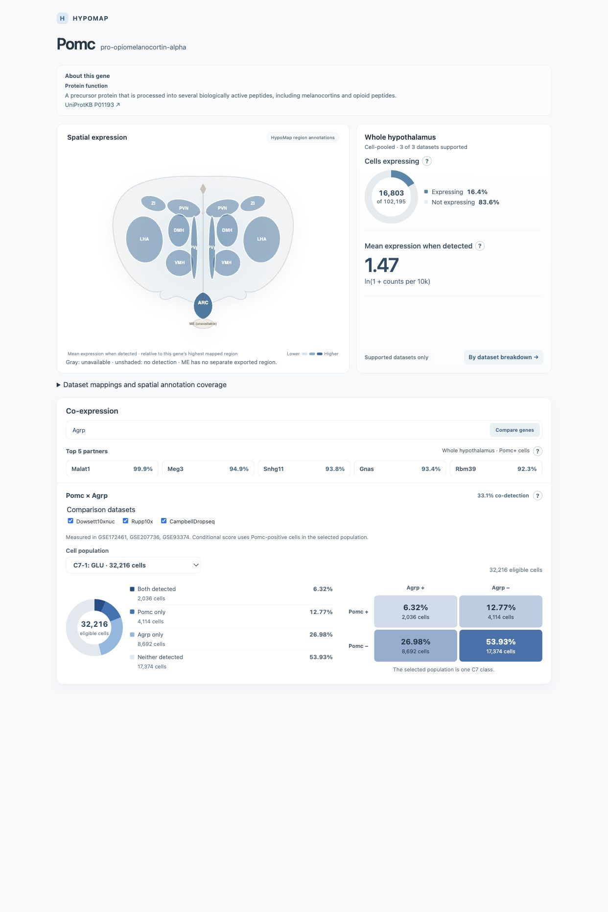

# Measured pair comparison service

Implemented 2026-10-15 for GSE207736, GSE172461, and GSE93374: 39,583 canonical
genes across 102,195 imported cells. The standalone navigation route can compare
any two distinct supported genes, select datasets, inspect measured C7 quadrants,
and expand whole-population quadrants into C7 composition. The five-gene FVP is
unchanged. Top 5 recommendations retain their exported ranking and dataset scope;
the comparison controls do not rerank them.

## Run locally

From the repository root, build the index once (requires the validated navigation
export and the three processed raw datasets):

```sh
python3 tools/build_comparison_index.py
```

The default output `processed/comparison_index/` is gitignored. The builder refuses
to overwrite an existing directory; use `--out-dir processed/comparison_index_next`
for a rebuild and pass the matching `--index-dir` to the service. An interrupted
build has no completed manifest and cannot be served.

Start the API from the repository root:

```sh
python3 tools/comparison_service.py
```

In another terminal, from `hypomap-viz/gene-explorer-js/`:

```sh
npm run build
npm run preview -- --host 127.0.0.1 --port 5173 --strictPort
```

Open [the navigation preview](http://127.0.0.1:5173/navigation-prototype.html?gene=Pomc).
Enter Agrp in the partner field and select Compare genes. The C7 selector and
quadrant buttons now show measured values. Vite development and preview servers
proxy `/api` to `127.0.0.1:8765`. The API binds loopback only. Hosted deployment
requires a Python service with the private index and an equivalent same-origin
reverse proxy; a static Vercel upload alone cannot provide these comparisons.

## Data and API contract

The index stores little-endian packed detection bits (`raw_count >= 1`) per
canonical gene and dataset, plus separate support states and annotation masks.
Native missing and duplicate mappings remain unsupported. The builder verifies
raw/cell/gene checksums against the navigation export and checks every supported
single-gene marginal against the exported count. Startup verifies index files,
source files, and the source export manifest before accepting requests. Source
changes require rebuilding the navigation export and comparison index.

`GET /api/health` returns readiness and dataset IDs.

`GET /api/compare?a=MGI_ID&b=MGI_ID&datasets=ID,ID&region=REGION`

- `a` and `b` are distinct canonical MGI IDs from the navigation search index.
- `datasets` defaults to all indexed datasets; explicit lists must be nonempty,
  unique, and valid. The UI exposes independent comparison dataset checkboxes.
- `region` defaults to `Whole hypothalamus`. Named exported regions are supported
  by the API; the current comparison UI exposes Whole/C7 populations only.
- Each dataset must map both genes uniquely. Unsupported datasets are excluded
  and disclosed with each gene's mapping state. No supported datasets produces
  `state=unsupported`, zero eligible cells, and undefined percentages.
- Response contains per-dataset and pooled quadrant counts, eligible counts,
  quadrant percentages, conditional percentages, and C7 breakdowns including
  `Unannotated C7`. No individual cell identifiers or detection bitsets are sent.
- Four quadrant keys: `both`, `queryOnly`, `partnerOnly`, `neither`.
- Quadrant percentages divide by the chosen population's eligible cells.
  Conditional percentage divides `both` by `both + queryOnly`.
- Zero eligible cells makes quadrant percentages undefined (`null`); zero
  query-positive cells makes the conditional percentage undefined.
- Counts pool before percentages are calculated. Every C7 partition must
  reconcile with its dataset's population and all four quadrants.
- Quadrant composition divides each C7 quadrant count by the whole quadrant's
  count. It differs from the within-C7 quadrant percentage.

The API caches up to 512 comparisons; the browser caches up to 128 successful
responses. Gene IDs, datasets, and optional region identify a request. UI request
counters prevent delayed results replacing newer gene/partner/dataset selections.
Failures show Retry; an unavailable service does not manufacture pair values.

## Size, validation, and expansion

Measured generated index: **511,259,299 bytes** (511.26 MB decimal), stored on the
server rather than in the static app export. It includes source/index manifests
and annotation masks. A request returns only summary counts.

Validation commands:

```sh
python3 tools/test_comparison_service.py
python3 tools/validate_comparison_service.py
```

The second requires the running API. It independently extracts boolean vectors
from raw sparse matrix columns for 14 pairs, checks 369 dataset/C7 population
blocks, verifies dataset subsets and regional masks, checks swapping genes and
pooled/C7 reconciliation, and rejects invalid requests. It writes
`docs/comparison_validation_results.json` and raw-validated UI fixtures.
UI tests additionally cover arbitrary pairs, zero detection, unsupported mappings,
retry, caching, and stale responses:

```sh
cd hypomap-viz/gene-explorer-js
node tests/navigation.test.mjs
node tests/navigation-audit.mjs
```

Observed mean cached localhost HTTP round trip was approximately 0.72 ms over 20
requests during the initial validation; this is not a production latency promise.

The implementation derives its dataset list from the validated navigation export,
with no three-dataset bitmask limit. Expanding requires importing each dataset,
validating mappings/annotations, regenerating navigation summaries and the index,
and restarting the service. Index storage scales with genes × imported cells;
all-pair tables are never generated. Public hosting, authentication/rate controls,
and multi-worker deployment are separate deployment work.

## Browser verification (2026-10-15)

The production preview passed Pomc × Agrp arbitrary comparison, whole-population
quadrant expansion, C7-1 GLU selection, and removal/restoration of CampbellDropseq.
Whole-population Both = 5,519 / 102,195 eligible cells; GLU Both = 2,036 / 32,216.
The two-dataset whole population updates to 81,109 eligible cells. Browser warning
and error logs were empty. The final preview remains open on the three-dataset
GLU comparison.


