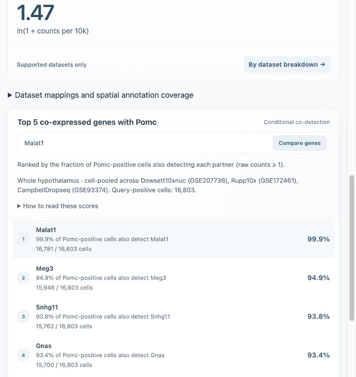
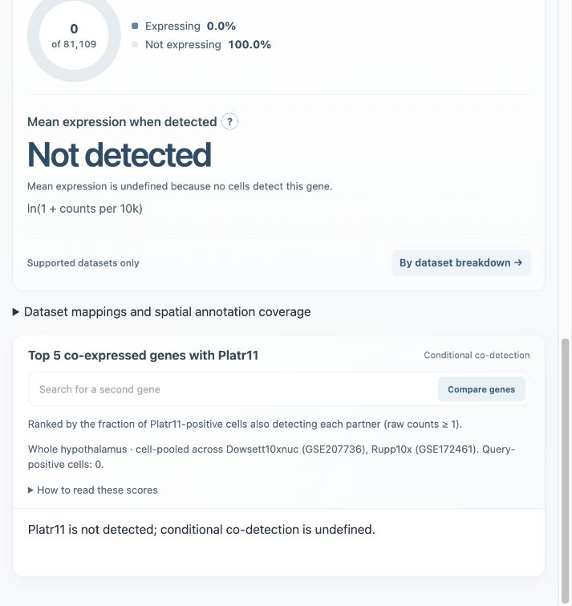
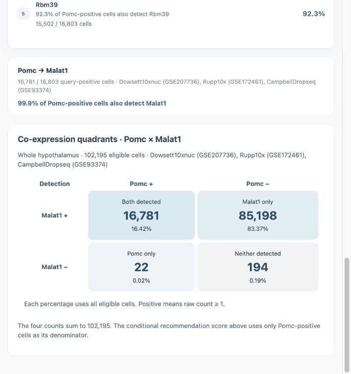
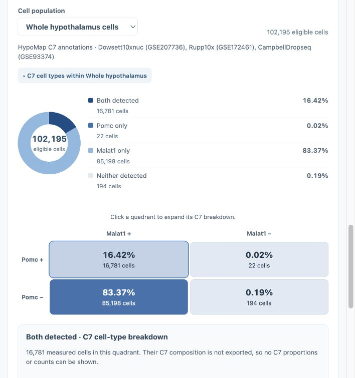
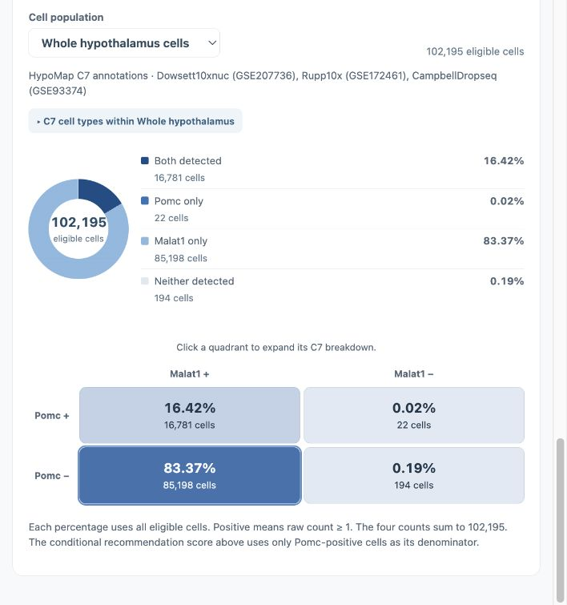
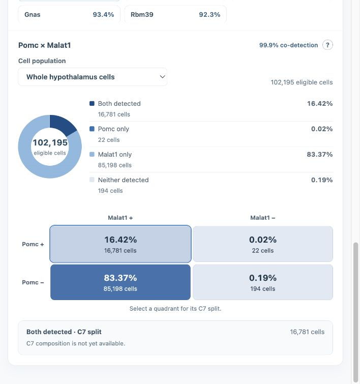
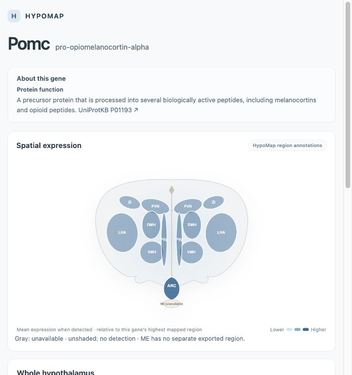

# Navigation validation — checkpoints 1–5 complete

Final validation completed 2026-10-09. The latest app passed the export audit,
integration tests, production build, and five-gene browser checks. The preview is
running locally; no deployment was performed.

- Full export validation: 158 payloads; 39,583 gene and recommendation records passed.
- Independent comparison with the existing FVP reference: 255 dataset/context metric blocks passed (positive counts, denominators, log-expression sums).
- Integration tests and production build passed.
- Browser checks: Pomc expression and Top 5 selection, accumulating mouse/keyboard dataset cards, mean formula popover, Cyr61 → Ccn1 deep link, linc1405 ambiguity choices and explicit Platr11 selection, and real zero-detection/empty recommendations. Browser warning/error log was empty.

| Gene | Positive / eligible cells | Expressing | Positive-cell mean | Top partner | Both-positive | Conditional score |
|---|---:|---:|---:|---|---:|---:|
| Pomc | 16,803 / 102,195 | 16.4421% | 1.4740 | Malat1 | 16,781 | 99.8691% |
| Agrp | 29,471 / 102,195 | 28.8380% | 1.3677 | Malat1 | 29,451 | 99.9321% |
| Ccn1 | 4,570 / 102,195 | 4.4718% | 2.3944 | Malat1 | 4,568 | 99.9562% |
| Fam237b | 1,224 / 102,195 | 1.1977% | 1.2240 | Malat1 | 1,222 | 99.8366% |
| Npy | 14,521 / 102,195 | 14.2091% | 1.9497 | Malat1 | 14,492 | 99.8003% |

## Limits

- Recommendations were checked against exported counts and validator bounds; this pass did not rerun exhaustive raw-matrix ranking. The exporter’s recorded five-pilot exhaustive validation remains the ranking evidence.
- UI percentages round to one decimal; near-100% scores can display 100.0%. Exact numerator and denominator remain visible.
- Loading, missing-gene, and zero-expression presentation was completed at checkpoint 4; see state validation below.
- Arbitrary pair scores outside Top 5 require an on-demand backend.

## Repository handoff

The source commit includes the standalone route, shared descriptions, loader,
metric helpers, exporters, validators, tests, and five-gene FVP reference. Screenshots
below are versioned in `docs/navigation-demos/`; earlier images record intermediate
checkpoints, while the final two sections show the current refinements.

Generated navigation payloads and local scratch files are excluded from Git. A fresh
clone must regenerate or provision the export before building; the app README and
navigation-export README describe this prerequisite. The preview links below are
local URLs, not a deployed GitHub or Vercel site.

## Local demo

[Open gene explorer](http://127.0.0.1:5173/navigation-prototype.html?gene=Pomc)



## Checkpoint 4 — state validation

Completed 2026-10-09. Integration tests and production build pass. Controlled
loading/failure checks verify busy announcements, query preservation, fresh index
retry, shard retry, and stale-response protection. Real browser checks verify an
unknown query shows no expression metrics, a corrected search recovers, and
Platr11 shows zero detection in both spatial and dataset views: 0 of 81,109 supported
cells, undefined mean, empty conditional recommendations, and CampbellDropseq
separately unavailable. Final checkpoint-5 validation is complete; see the final audit below.

[Missing-gene demo](http://127.0.0.1:5173/navigation-prototype.html?gene=not-a-real-gene-xyz)
· [Zero-expression demo](http://127.0.0.1:5173/navigation-prototype.html?gene=Platr11)



## Measured quadrant restoration

Validated 2026-10-09. Tests and build pass, including integer/count conservation,
same-dataset marginals, invalid input rejection, partner load recovery, and stale
selection handling. Browser confirms Pomc × Malat1: 16,781 both, 22 Pomc-only,
85,198 Malat1-only, 194 neither; total 102,195. No warnings/errors logged. Export
payload size is unchanged. This validation uses exported counts, not a new raw-matrix
intersection scan. Arbitrary pairs outside Top 5 remain unavailable.



## Prototype Coexpression formatting and C7 expansion

Validated 2026-10-09. Integration checks cover the donut/legend/matrix layout,
measured C7 populations summing to the pair population, Unannotated C7 retention,
quadrant expansion, unavailable C7 profiles, and selection resets. Browser checks
confirm both expansion controls and C7 selection. C7-1 GLU = 32,216 eligible cells;
Unannotated C7 = 18,658 in the three-dataset Pomc pair population. C7 pair counts
remain unavailable because the earlier reference profiles were illustrative and
this export contains only C7 population totals.



## Checkpoint 5 — final audit and preview

Completed 2026-10-09 against the final app, including quadrant and C7 formatting.

- `tests/navigation-audit.mjs` compares five genes against the existing FVP reference:
  255 dataset/context blocks check exact detection counts and eligible counts,
  log-expression sums (relative 1e-12 / absolute 1e-9 tolerance), and percentages
  and positive-cell means (absolute 1e-12 tolerance).
- All 25 Top 5 pair quadrants have nonnegative integer counts summing to the same
  supported eligible population; query-positive marginals agree with gene shards.
- C7 populations sum to the exact pair population and preserve Unannotated C7.
- The built page/modules and all 158 production payloads match source/export bytes.
- The full export validator checks all 39,583 gene and recommendation records.
- Integration tests cover aliases, ambiguity, loading, failures/retry, zero and
  unsupported states, stale responses, pair quadrants, and C7 formatting.
- Live browser checks verify displayed counts, percentages, and means for Pomc,
  Agrp, Ccn1, Fam237b, and Npy, plus Cyr61 and Gm8773 alias routes. The final Pomc
  × Malat1 preview is open with the measured donut/legend/matrix. No browser
  warnings or errors were logged.

Machine-readable results: [`navigation_validation_results.json`](navigation_validation_results.json).
This audit compares exported summaries and checks quadrant arithmetic; it does not
rerun raw-matrix pair intersections or exhaustive ranking. Measured C7-specific
pair results and arbitrary pairs outside the Top 5 remain unavailable.

Re-run from `hypomap-viz/gene-explorer-js/`:

```sh
npm run build
node tests/navigation.test.mjs
node tests/navigation-audit.mjs
```

Start the preview with `npm run preview -- --host 127.0.0.1 --port 5173 --strictPort`
and open `/navigation-prototype.html`.



## Coexpression simplification

Validated 2026-10-09 after user feedback. The earlier view's compact interaction
model is restored with one comparison card, direct recommendation selection, one
population selector, and formula/provenance detail behind `?`. Removed duplicate
pair-summary cards, repeated per-partner sentences, population navigation lists, and
repeated unavailable C7 charts/rows. Exact count/score semantics remain available.
Integration tests, production build, and the 255-block/25-pair/158-payload audit pass.
Browser checks verify direct pair selection, formula popover, C7 selection, return
via the same selector, and inline quadrant expansion. No warnings/errors logged.



## UniProt description restoration

Validated 2026-10-09. Existing curated descriptions were moved unchanged to shared
`gene-descriptions.mjs` and restored beneath the navigation gene heading. Build,
integration tests, and the final export audit pass, including the copied module's
byte identity. Browser checks confirm Pomc/P01193 and Cyr61 → Ccn1/P18406 summaries
and correct direct links. No warnings/errors logged. Descriptions were reused from
the previous app version; this pass does not claim a fresh UniProt source audit.


